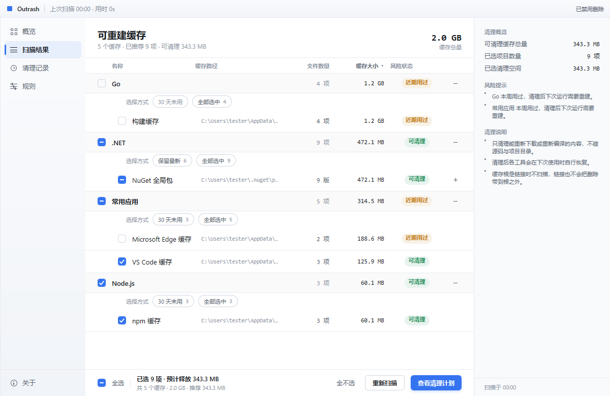

# outrash

硬盘上到处是不需要留着的缓存：npm 的包、Go 的编译产物、NuGet 下载过的库、浏览器存下的网页资源……它们占着几个 GB，但删掉不会丢东西——下次用到时对方自己会重新下载或重新编译。

问题从来不是"该不该删"，而是"哪一堆能删"。outrash 就是回答这个问题的：它去各个程序默认会用的位置扫一遍，把找到的缓存按分组列出来，标上大小和最后使用时间，你看着勾选，按一次按钮清掉。

它一开始只认识开发工具，现在范围放宽到所有"删了能自己回来"的缓存，开发工具和常用应用都在里面。



左边是概览、扫描结果、清理记录、规则四页。中间一张表，五列：工具、缓存路径、文件数量、大小、风险状态。右边汇总能清多少、已经勾了多少。窗口窄于 1160 像素时右边整块收起来，表格不被挤压。

凡是被标记为"近期用过"的缓存，清理之后下一次运行会有可感知的等待——这是你觉得值不值得清的另一个依据。

## 能清理什么

一共 9 组、32 个缓存项：

| 分组 | 缓存 |
|---|---|
| Node.js | npm、pnpm、Yarn、Bun、Deno、Playwright 浏览器、Electron 二进制、Cypress 二进制 |
| .NET | NuGet 全局包、NuGet 下载缓存 |
| Go | 构建缓存、模块缓存 |
| Rust | Cargo 注册表、Cargo Git 依赖 |
| Python | pip、uv、Poetry、Conda |
| AI 模型 | Hugging Face 模型缓存 |
| JVM | Gradle |
| 常用应用 | Edge、Chrome、Firefox、VS Code、Slack、Discord、Teams、Spotify |
| 其他 | Flutter / Dart、Composer、Swift Package、vcpkg |

每个程序的缓存位置先读它自己的环境变量（比如 `npm_config_cache`），没有就退回到各平台的默认目录。浏览器和聊天软件按配置文件各存一份缓存，规则里用通配符匹配，所以新建的配置文件也会被扫到。

## 它不会做的事

删东西这件事上，宁可少做也不多做：

- **列表就是计划。** 勾上的就是会被删的路径，界面上没有第二份清单，也没有"顺手一起清"的东西。
- **只碰扫描时量到的东西。** 只有真实存在、位于规则里声明的缓存目录之下、并且不是那个目录本身的路径才会进删除器；扫描和清理之间改规则也不会扩大范围。
- **链接不跟。** 缓存目录本身是链接时整项不扫描；计划里任何一层是链接时那一项被拒绝。所以链接不会把删除带到声明范围之外。
- **离根太近的一律拒绝。** 不是绝对路径、等于盘符根、或者只隔着盘符一级的，删除器直接拒绝。
- **只清能重新拿回来的东西。** 源码、项目目录、控制台，一律不碰。Poetry 的 `virtualenvs`、Hugging Face 的 `blobs` 和 `.locks` 这种和缓存住在一起、但重建不回来的子目录，规则里显式排除，既不进列表也不计入大小。
- **不写任何东西。** 没有配置文件，没有注册表，没有日志，没有历史记录。"清理记录"那一页只活在内存里，关掉窗口就没了。

## 构建与运行

```sh
just build       # 精简构建，约 9.9 MB，输出到 build/
just build-full  # 不剥符号的对照构建，保留控制台，调试用
just release     # 打包构建，带版本号和应用标识
just debug       # 不删除：把计划打印到终端，界面上点"查看清理计划"能看到清单
just safe        # 正常界面，但拒绝执行任何删除
go run .         # 直接跑
```

Windows 上 `build` 和 `release` 是 GUI 子系统，双击只开界面；`build-full` 保留控制台子系统，方便从终端调试——GUI 子系统的 exe 在终端里看不到 stdout 和 stderr，而 `-debug` 的计划正好是打到 stdout 的。

`just ci` 跑 build、vet 和测试。`just lint`、`just race`、`just cover` 分别跑 mygo 的 UI 生命周期检查、竞态检测和覆盖率。`just build-full` 是 `just build` 去掉 `-s -w -trimpath` 和 `-buildvcs=false` 的样子（14.2 MB 对 9.9 MB）。

## 加一个缓存

所有规则都在 `internal/core/rules.json`，构建时用 `go:embed` 打包进二进制。

往分组里加一个 item：

- `id`、`name` 必填，`note` 会显示在列表和计划里，说明这个缓存怎么回来。
- `env` 是优先读的环境变量。
- `paths` 按 `windows` / `darwin` / `linux` 给路径模板，支持 `~` 和 `%VAR%`。
- `unit` 是 `entries`（默认，缓存目录下每个子项算一项）或 `versioned`（结构是 缓存目录/包/版本，可以"保留最新"）。
- `exclude` 列出住在缓存目录里、但不能删的子目录，它们既不出现在列表里也不计入大小。
- `probe` 可选，用来问工具自己的缓存位置——只在环境变量没设、默认路径也都不存在时才会调用。

## 开发

```sh
go test ./...
go tool mygo vet .
```

## 许可

MIT，见 [LICENSE](LICENSE)。
