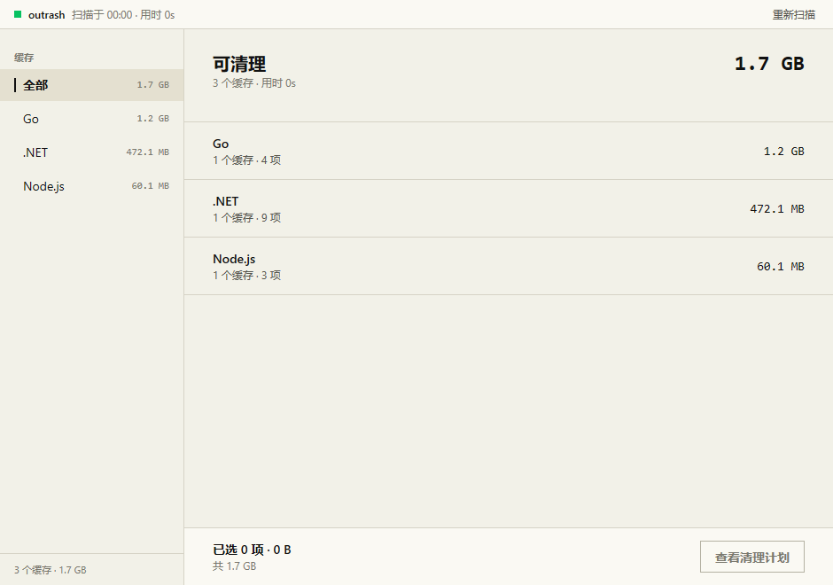

# outrash

扫描本机开发工具的缓存目录，列出可以重新下载或重新编译的内容，只有你在按大小排序的清理计划里确认后才会删除。



## 安全约定

- 没有查看并确认计划，就不会删除任何东西；应用只生成计划，删除只发生在计划页的“执行清理”之后。
- 只有扫描时量到的、位于 `rules.json` 缓存根之下的路径才可能进入计划，且不能等于缓存根本身。
- 盘符根和盘符下一级目录一律拒绝，计划项本身是符号链接时也拒绝（扫描不跟随链接）；主目录本身不会被列为计划项。
- 计划里只出现各工具能自行重新下载或重新编译的内容。
- 不写配置、注册表、日志或历史；除删除动作本身外没有任何持久化。

## 构建与运行

```sh
go run .              # 打开窗口，扫描后按工具分组显示
go run . -debug       # 查看计划时把路径、大小和顺序打印到 stdout，并禁用删除
go run . -no-delete   # 正常界面，但拒绝执行任何删除
```

`-debug` 隐含 `-no-delete`。

## 添加一个缓存

规则都在 `rules.json`，通过 `go:embed` 在构建时打包。在分组里加一个 item：`id`、`name` 必填；`env` 是优先读取的环境变量；`paths` 按 `windows`/`darwin`/`linux` 给出路径模板，支持 `~` 和 `%VAR%`；`unit` 为 `entries`（默认，根的每个子项算一项）或 `versioned`（根/包/版本，可执行“保留最新”）。可选的 `probe` 会在环境变量未设置且默认路径都不存在时调用工具查询自己的缓存位置。

## 开发

```sh
go test ./...
go tool mygo vet .
```
